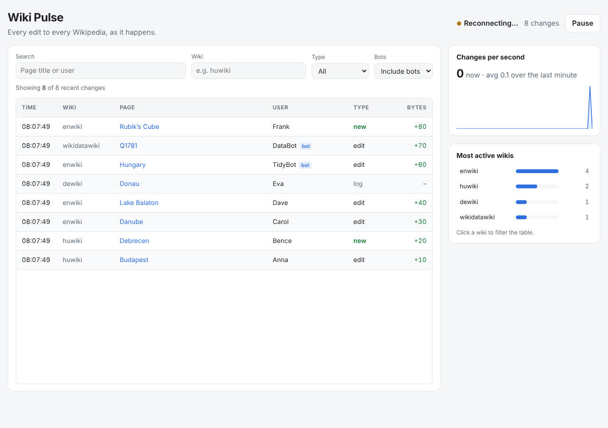

# Wiki Pulse

A live dashboard of every change made to Wikipedia and its sister projects, streamed in real time from Wikimedia's public [EventStreams](https://wikitech.wikimedia.org/wiki/Event_Platform/EventStreams_HTTP_Service) feed and rendered with React.

**Live demo:** https://patyig.github.io/wiki-pulse/ <!-- update after the first deploy -->



## What it does

- Streams Wikipedia's recent changes (often 30+ per second) over Server-Sent Events.
- Shows them in a virtualized table that stays smooth with thousands of rows.
- Filters by wiki, change type, bots and free-text search; filters live in the URL, so a view can be shared.
- Charts changes per second over the last minute and ranks the most active wikis; click a wiki to filter.
- Pauses the table without losing data: changes received while paused are merged back on resume.
- Works on mobile and in dark mode, with keyboard focus styles and ARIA roles on the grid.

## How it is built

| Concern | Approach |
| --- | --- |
| Streaming | Native `EventSource` (`src/stream/connect.ts`), which reconnects on its own; status is mirrored into the store. |
| State | A small external store (`src/store/store.ts`) read through `useSyncExternalStore`. Events are queued and applied in one batch every 250 ms, so React renders about 4 times a second instead of once per event. Each flush produces a new immutable snapshot. |
| Memory | The table buffer is capped at 2,000 events; statistics keep counting everything. |
| Rendering | `@tanstack/react-virtual` keeps only the visible rows in the DOM; rows are memoized and positioned with `transform`. |
| Charts | Plain SVG, no chart library. |
| Safety | Links from the stream are only rendered for `http(s)` URLs. The stream URL is fixed, not configurable from the address bar. |
| Tests | Unit tests for parsing, the store (batching, caps, pause, the sliding window) and filters with Node's built-in test runner; Playwright end-to-end tests on desktop and mobile, with the Wikimedia stream mocked. |
| CI/CD | GitHub Actions runs type checks, unit and end-to-end tests on every push, and deploys `main` to GitHub Pages. |

Runtime dependencies are deliberately few: React, React DOM and TanStack Virtual.

## Run it locally

```bash
npm install
npm run dev          # http://localhost:5173
npm test             # unit tests
npx playwright install chromium
npm run test:e2e     # end-to-end tests (builds and serves the app)
```

## Possible next steps

- Per-wiki drill-down with a longer history (IndexedDB).
- A Web Worker for parsing when the stream is very busy.
- Diff previews via the MediaWiki API.

## About

Built by [Gábor Patyi](https://www.linkedin.com/in/g%C3%A1bor-p-067104288/), frontend engineer in Budapest. Developed with AI assistance (Claude), which is how I work day to day; the design decisions, review and tests are mine.

Data: Wikimedia EventStreams, content licensed under CC BY-SA. Not affiliated with the Wikimedia Foundation.
